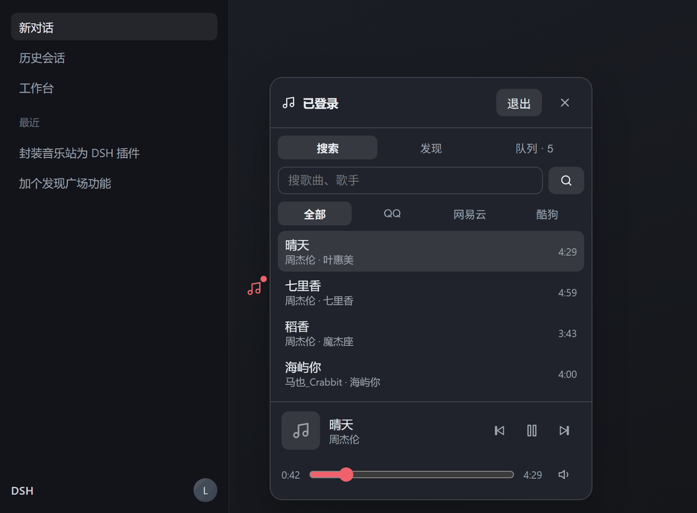
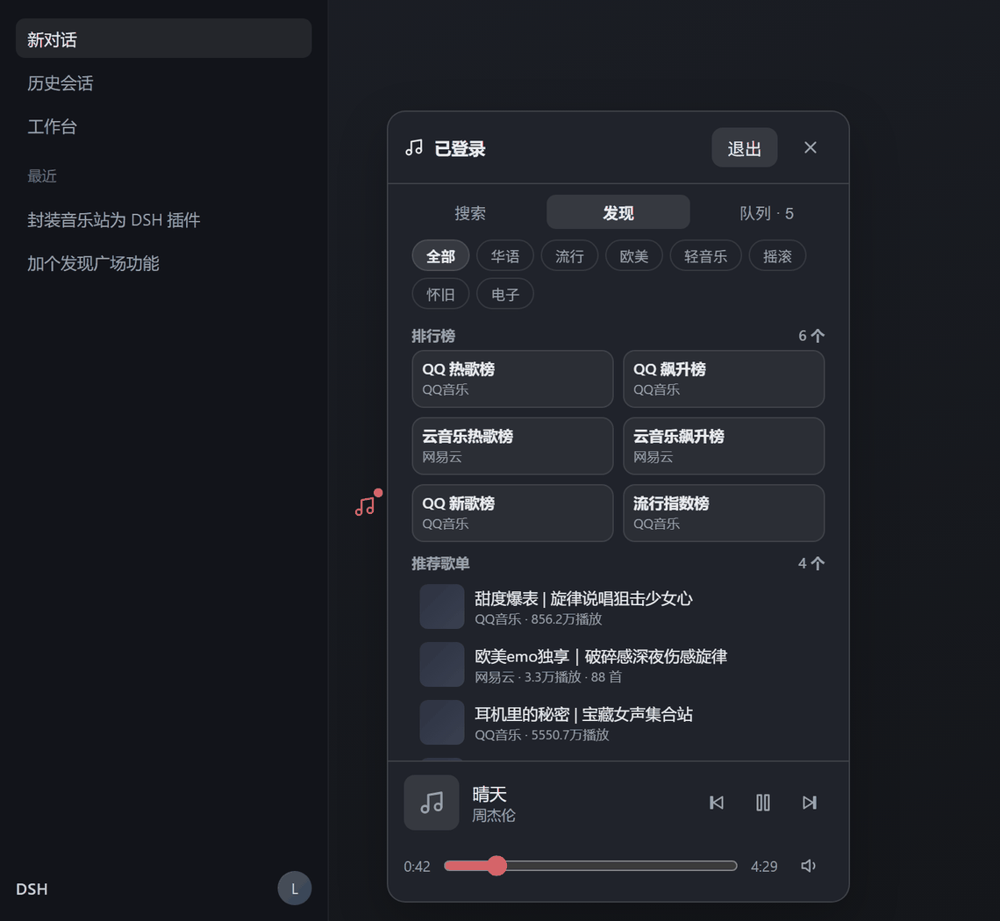
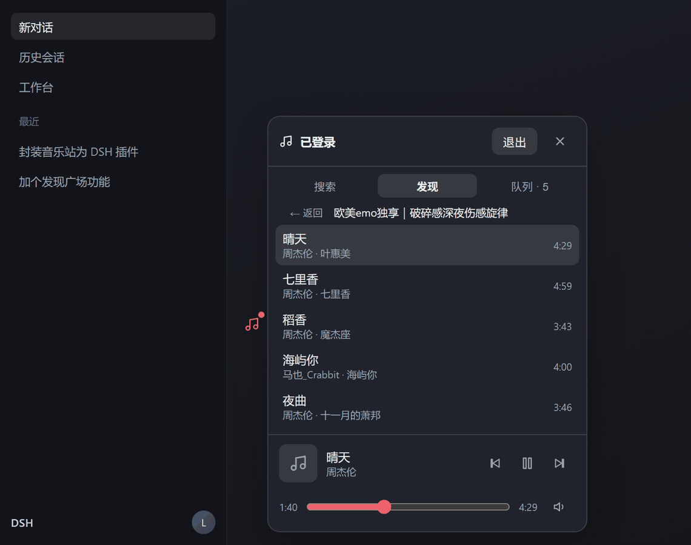
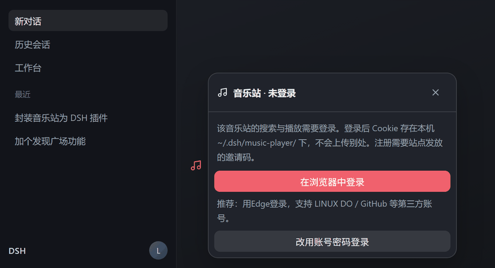

# dsh-music-player

> 在 [DeepSeek Harness](https://github.com/deepseek-ai/deepseek-harness) 侧边栏底部常驻一个迷你音乐播放器，边工作边听歌。

把无损音乐站搬进 DSH：搜索、发现、播放队列都在侧边栏里完成，不占窗口、不打断对话。

<p align="center">
  
</p>

<p align="center">
  <a href="screenshots/02-discover.png"></a>
  <a href="screenshots/03-playlist.png"></a>
</p>

<p align="center">
  <sub>左：发现广场（排行榜 + 推荐歌单）　右：歌单曲目，点任意一首播放整张列表</sub>
</p>

<p align="center">
  
</p>

<p align="center">
  <sub>未登录时的引导：一键拉起系统默认浏览器完成登录，插件自动取回登录态</sub>
</p>

> 截图为真实组件渲染，歌名与账号为演示数据。

## 功能

| 能力 | 说明 |
|---|---|
| **常驻迷你播放器** | 侧边栏底部一个音符按钮，播放时带小红点，随时点开或收起 |
| **搜索听歌** | 关键词搜索，可切 全部 / QQ音乐 / 网易云 / 酷狗 |
| **完整播放控制** | 播放 / 暂停 / 上一首 / 下一首 / 拖动进度 / 音量 / 静音，播完自动下一首 |
| **播放队列** | 搜索结果整列入队，在「队列」页随时切歌 |
| **发现广场** | 排行榜 + 推荐歌单，点进去就是可播放的曲目列表 |
| **音质可切** | 三档切换：流畅优先（320k）/ 无损优先（FLAC）/ 站点最高档，按平台标识分别归一 |
| **默认浏览器登录** | 拉起系统默认浏览器，复用你已有的第三方授权与密码自动填充 |
| **跟随主题** | 只用 `--dsw-alias-*` 主题令牌，深色 / 浅色自动适配 |

## 设计取舍：为什么不是套个网页

上游站点返回 `X-Frame-Options: SAMEORIGIN`，**禁止被 iframe 嵌入**；且它的搜索、榜单、取音频地址接口都要求登录，跨域也带不上 Cookie。所以这个插件没有套壳网页，而是拆成两半：

- **Host 半部**（`index.js` + `lib/site.js`）用 Node 直连上游接口，负责登录、搜索、换取音频地址，并把音频以本地路由转发出去；
- **Client 半部**（`client.js`）用 React 画播放器，挂在 `sidebar.footer.action` 插槽（设置按钮旁边那排）。

好处是**凭据不出本机、也不进网页**：登录态只存在本地磁盘，客户端始终只拿到一个不透明的本地地址，音频经本地转发还能绕开上游 CDN 的 Referer 校验，并支持拖动进度条（Range 请求）。

## 安装

需要 DSH `>= 0.2.2-rc.1` 与 Node `>= 20`。

```powershell
# 1. 取源码
git clone https://github.com/Menpengpeng/dsh-music-player.git
cd dsh-music-player

# 2. 装进 DSH 的 profile（<profile> 通常是 desktop）
dsh plugin --profile desktop add "file:$PWD"

# 3. 重启 DSH
```

`dsh plugin` 本质是把参数转发给 profile 目录下的 pnpm，所以 `add` / `remove` 的用法与 pnpm 一致。也可以手动把本仓库放进 `<profile>\node_modules\dsh-music-player`，并在 `<profile>\package.json` 的 `dependencies` 与 `dsh.profile.bundles` 里登记包名 `dsh-music-player`。

重启后，侧边栏底部（设置齿轮旁）会出现音符图标。

## 使用

1. 点音符图标打开面板 → 首次会要求登录；
2. 点 **「在浏览器中登录」**，插件拉起你的**系统默认浏览器**打开站点，你正常登录（LINUX DO / GitHub 等第三方授权，或账号密码）；
3. 登录成功后插件自动取回登录态并关闭那个浏览器窗口；
4. 切到「搜索」或「发现」，点任意一首即开始播放。

> **注册需要站点发放的邀请码**，插件不代办注册。

## 登录是怎么做的（以及为什么这样）

这是本插件最容易被误解的部分。

该站使用 OAuth 第三方登录，**回调地址固定在站点自己的域名下**，改不成指向本机，所以用不了「本地起回调服务器收 code」那一套；同时会话 Cookie 是 HttpOnly 的，前端脚本读不到。因此插件采用 **CDP 桥接**，并且优先使用你的系统默认浏览器（Windows 下读注册表 `UserChoice` 判断）：

1. 点「在浏览器中登录」，Host 用 `--remote-debugging-port` 拉起**你的默认浏览器**，直接打开站点；
2. 你在窗口里正常登录，密码只输给站点本身；
3. Host 通过 DevTools 协议读回该站点的 Cookie，调用 `/api/auth/me` 验证确实已登录；
4. 验证通过才写入 `~/.dsh/music-player/session.cookie`（权限 0600），随即自动关闭浏览器窗口。

几个要点：

- **用的是默认浏览器本身**，不是另装一个，登录习惯、密码自动填充、第三方授权状态都和你平时一致；
- 但窗口跑在**专用 profile** 里（`~/.dsh/music-player/browser-profile`），不会动你日常的书签与历史；删掉该目录即可重置；
- 插件**看不到你的密码**，只拿得到最后的 Cookie；
- 站点会给未登录访客也发一个 `dl_client_token`，所以插件不会「有 Cookie 就当登录成功」，而是每次都向 `/api/auth/me` 求证；
- 若默认浏览器是 Firefox 这类挂不了 CDP 的，会自动退回家里的 Chrome/Edge；一个都没有时退回账号密码登录。

**为什么不能直接读你日常浏览器里的登录态**：Chrome / Edge 自 v127 起启用 App-Bound Encryption，Cookie 库在运行时被独占锁定，实测既拿不到库文件快照、也解不开 v20 密文。所以只能「在专用 profile 里登录一次」，这也是同类工具的通行做法。

## 接口约定

客户端只和 Host 通信，不直接碰上游：

| 方法 | 路径 | 说明 |
|---|---|---|
| GET | `/api/music-player` | 查登录态、账号、额度 |
| POST | `/api/music-player` | `{type:'login' \| 'logout' \| 'search' \| 'discover' \| 'playlist' \| 'chart' \| 'resolve' \| 'browserLogin' \| 'browserPoll' \| 'browserCancel'}` |
| GET | `/api/music-player/audio?k=<key>` | 音频转发（支持 Range） |

`resolve` 不返回上游原始地址，而是返回本地转发地址：既不暴露上游域名，也避免变成开放代理——只有插件自己换到的链接才会被转发，且 key 有上限（LRU 300 条）。

## 取链流程：为什么要点两次接口

站点的数据分两步才拿得到播放地址，这里容易踩坑：

1. `GET /api/music/search?q=…` → 只给歌名、歌手、封面和**歌曲页面链接**，`audio_qualities` 恒为空；
2. `POST /api/parse {text: 歌曲页面链接}` → 才返回音质列表，每档带 `quality / format / song_id / media_mid / lazy`；
3. `POST /api/music/resolve {…}` → 返回**站点相对路径** `/api/download?token=…&inline=true`；
4. 该地址需携带登录 Cookie，且支持 `Range`（可拖动进度条）。

`site.resolveTrack()` 把这几步串起来。注意不能因为「某档已带直链」就跳过更高音质：站点给 128k 预置了直链，按那个逻辑会永远播不出无损。

### 为什么默认给 320k 而不是无损

上游站点对**单个连接限速**，实测约 1.3~1.7 Mbps（同样的机器跑 Speedtest 有 19 Mbps，所以瓶颈在站点不在本机）。而无损 FLAC 的码率常在 900~1100 kbps：

| 音质 | 体积（晴天 / 269s） | 播放所需带宽 | 实测吞吐 | 余量 |
| --- | --- | --- | --- | --- |
| FLAC | 52.8 MB | 201 KB/s | ~191 KB/s | **0.9x** ❌ |
| 320k mp3 | 10.3 MB | 39 KB/s | ~175 KB/s | **4.5x** ✅ |
| 128k mp3 | 4.1 MB | 16 KB/s | ~205 KB/s | **13x** ✅ |

FLAC 所需带宽贴着上限，网络稍有抖动缓冲就耗尽，表现正是「卡一下、缓过来、再卡」。所以默认 `balanced`（320k），并保留 `lossless` / `highest` 两档给想听无损的用户——那是用流畅度换音质的选择，由用户自己决定。

另外两层兜底：`preload="auto"` 让浏览器提前预读；播放中若 `waiting` 持续超过 4 秒且当前是无损档，会自动降一档并从原进度续播，只在本曲内降一次。

`/api/download` 的 token 可重复使用，连续 Range 请求不扣配额，所以拖动进度条不会消耗每日额度。

## 发现广场

面板里的「发现」标签页，数据来自站点自身的发现页：

| 动作 | 上游接口 | 说明 |
|---|---|---|
| `discover` | `GET /api/music/discover/home?category=<分类>` | 一次返回分类、榜单卡片、推荐歌单；`category` 省略即「全部」 |
| `playlist` | `GET /api/music/discover/playlist?platform=&playlist_id=&limit=` | 歌单曲目 |
| `chart` | `GET /api/music/discover/chart/<key>` | 榜单曲目 |

**分类只影响歌单，不影响排行榜**——这是接发现页时容易误判成「筛选没反应」的地方：上游的 8 个榜单（QQ 热歌榜等）是**全站榜**，任何分类下都返回同一批；真正随分类变化的是下方推荐歌单（华语出华语歌单、摇滚出摇滚歌单）。因此界面上把榜单区标注为「全站 N 个」，歌单区标题带上当前分类名，切换时还有一条轻量加载提示，避免用户以为点击没生效。

另外两个细节：站点对不认识的分类（如「民谣」）会**静默回退成「全部」**，所以选中态用「用户点的那一个」而不是后端回显值，否则按钮会突然跳回去；加载中允许切换到别的分类（否则连点第二下会没反应），只拦重复点同一分类。

**音质标识各平台不统一**，这是接发现页时踩到的坑：QQ 用 `flac / 320mp3 / 128mp3 / 96aac`，网易云用 `lossless / exhigh / higher / standard`。若只按 QQ 的标识做排序表，网易云的无损会被当成未知档排到最后。因此 `site.qualityRank()` 同时识别两套标识，并在认不出时按 `format` 兜底。

## 命名与规范

包名遵循 DSH 插件命名约定，对照官方校验正则 `^(?:@[a-z0-9][a-z0-9._~-]*/)?[a-z0-9][a-z0-9._~-]*$`：

| 项 | 取值 | 依据 |
|---|---|---|
| 包名 | `dsh-music-player` | 与 `dsh-media-desk`、`dsh-free-search` 等官方插件一致，用 `dsh-` 前缀的裸包名 |
| entry id | `music-player` | 包名去掉 `dsh-` 前缀的短名，与 `media-desk`、`better-sidebar` 一致 |
| 客户端模块 id | `dsh-music-player` | 必须与包名相同，否则 client-modules 的依赖图对不上 |
| 显示名称 | `locale/*.json` 的 `meta.title` | 由宿主从 locale 读取，缺省才回退到 `package.json.name` |

`dsh.client` 只接受四个字段：`platform`（必填）、`inject`、`external`、`immediately`。`inject` 声明的必须是**真实存在的客户端包名**，且要覆盖插件实际用到的服务提供者——本项目用 `ctx.slots`（由 `@deepseek-ai/dsh-client-ui-renderer` 提供）注册 `sidebar.footer.action`（由 `@deepseek-ai/dsh-client-ui-sidebar` 提供）。

## 已知限制

- **必须登录**：上游未登录时搜索与播放全部返回 401，这是站点策略，不是插件缺陷。
- **版权与额度**：站点对部分曲目限制音质或需要会员，插件按音质优先级自动降级，全都拿不到时给出提示；每日配额由站点侧管理，插件只透传、不做额度缓存。
- **上游直链有时效**：每次播放都重新取链，不做长缓存。
- **仅流式播放**：音频经本地转发但不落盘，关掉 DSH 也就停了；目前没有「下载到本地」功能。
- **尚未实现**：收藏、自建歌单、听歌历史、歌词（上游有对应接口，可后续扩展）。
- **平台**：登录桥接依赖 CDP，浏览器登录在 Windows 上验证完整；macOS / Linux 的默认浏览器探测尚未测试。

## 目录结构

```
dsh-music-player/
├── index.js             # Host 入口：注册路由、音频转发、浏览器登录编排
├── lib/site.js          # 上游站点客户端：凭证、登录、搜索、取链
├── lib/browser-login.js # 浏览器登录：拉起默认浏览器并通过 CDP 取回 Cookie
├── client.js            # 客户端：侧边栏迷你播放器（React）
├── cordis.patch.yml     # 打包补丁
├── screenshots/         # README 截图
├── locale/{zh,en}.json  # 插件显示名与描述
├── icon.svg
└── package.json
```

## 许可

代码以 [MIT](LICENSE) 发布。

本插件只是上游站点的第三方客户端，**不托管、不分发任何音频文件**；音乐版权归各平台与版权方所有，请遵守站点服务条款。若站点方认为本项目不妥，可开 issue 联系删除。
